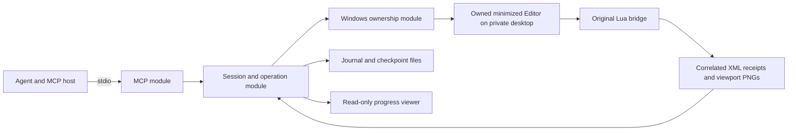
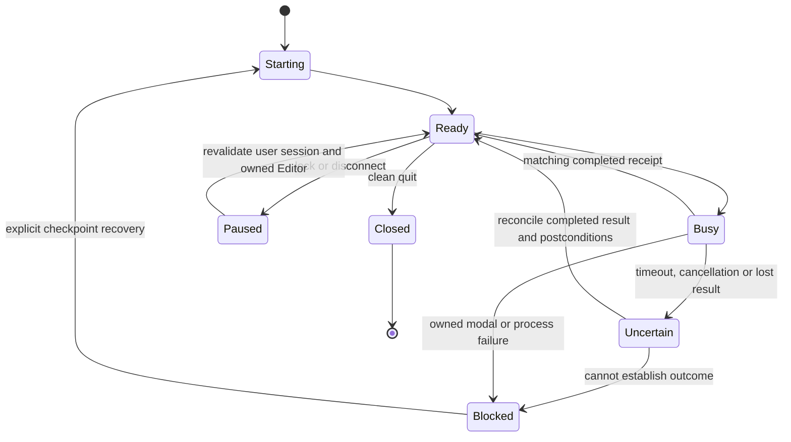

# Standalone Editor MCP design

Status: proposed architecture, based on research completed on 2026-10-17. This is specification input for McpForGiantsEditor; no MCP implementation is included.

Read [the proof of concept](proof-of-concept.md), [build plan](mcp-build-plan.md) and [publication/license review](../06-publication/publication-license-review.md) together. Technical feasibility is established only for the measured route; product requirements and release acceptance remain to be specified.

## Proposed product behavior

Build a local Windows MCP that owns a separate GIANTS Editor process and operates on a managed project copy. Start the process on an inactive private Win32 desktop and minimize its main frame before command traffic. Use independently written Lua through the installed scripting interface for scene work, and an externally observed native menu command for Save. Return structured scene data, operation status and native viewport images to the agent.

This remains a graphical application requiring the tested Windows graphics/session environment. It is not true headless execution, a Windows service or a Linux backend. A private Win32 desktop is also not a Windows virtual desktop and has no ordinary Win+Tab navigation contract.

Initial target: installed Editor 10.0.14.0 with the tested executable hash, legitimate FS25 installation and compatible game data. Supporting another Editor/GPU/Windows combination requires a recorded smoke test and capability check. GPU-driver versions are diagnostics, not permission to replace a user's driver. Unknown Editor builds fail before mutation; future updates use observed menu/API checks and explicit compatibility records.

The first release supports rigid part editing, inspection, import, parent-local transforms, bounded replacement, native Save checkpoints, fresh-load verification and snapshots. Terrain editing, skeleton/animation remapping, complete gameplay validation, arbitrary Lua execution and interactive desktop takeover are later capabilities.

## Executable integrity and legal assessment

The product must not modify the Editor executable. Reading the executable or influencing runtime behavior beyond ordinary bridge interaction requires assessment against the applicable legal and licensing framework during development.

## Architecture and ownership

Use Python with the official MCP SDK, Windows calls through typed `ctypes`, and a small original Lua bridge. This follows the proven implementation language and avoids introducing an additional native runtime before it is needed. Pin dependency and Python versions in the new repository after checking SDK/client compatibility. The SDK handles protocol-version differences; do not hand-code the 2026 wire exchange. The official [Python SDK](https://github.com/modelcontextprotocol/python-sdk) and [stdio specification](https://modelcontextprotocol.io/specification/2026-07-28/basic/transports/stdio) are the integration sources.

| Module | Interface and responsibility |
| --- | --- |
| MCP | Validated tool inputs/results, images/resources, client cancellation and progress. No Windows handles or menu IDs exposed to the model. |
| Session and operation | Owns the session state machine, one serialized Editor command, scene revisions, request deduplication and reconciliation. |
| Windows ownership | Creates/closes private desktop and job, validates executable/process creation identity/window membership, minimizes, discovers menu entries, dispatches bounded messages and inventories owned dialogs. |
| Lua bridge | Executes a fixed operation set, validates scene and node references, reports measurements and writes correlated native XML receipts. No general model-supplied source evaluation. |
| Journal and checkpoints | Durable operation intent/outcome, input hashes, file-change manifests, recoverable snapshots and restart epoch. |
| Viewer | Reads completed status/image artifacts. It has no Editor dispatch or desktop-switch authority. |

These are internal modules with narrow interfaces, not independently deployed servers or a generic plugin framework. Only the Windows-specific calls and the Lua wire exchange need adapters for focused tests. The MCP interface remains independent of the observed transport implementation.

Before opening a session, require a trusted host/user session grant that records the source/write roots and the emergency-close policy. The default proposed policy permits closing only this owned disposable Editor on bridge EOF/crash, with possible loss of uncheckpointed edits in the managed copy. Disclose that limitation once when the task/session is authorized; reuse the grant for routine work. It neither authorizes original-file overwrite nor discarding a different user process. If that loss policy has not been authorized, v1 refuses to start; a detached preservation supervisor is deferred.

One bridge instance owns one Editor session. Hold a per-user bridge lock. Do not attach to or close an Editor started by the user. Coexistence with another same-user Editor is unsupported in v1 until settings/log isolation has been proven; report the conflict instead of terminating it.

The private desktop is process/UI isolation, not a security sandbox. The Editor still runs with the user's normal filesystem rights. Path validation limits bridge requests; it does not turn the proprietary executable into an untrusted-code sandbox. Do not elevate the bridge or modify desktop ACLs.

## Installation and bootstrap

The user installs and licenses the Editor and game through GIANTS. The package ships original bridge code and synthetic fixtures only. It does not download vendor installers, copy game assets into its distribution or silently accept vendor terms.

First setup records the Editor path, compatible game root, managed workspace root and allowed source roots. Generate a minimal session configuration from original code. Keep the user's normal configuration and Program Files unchanged. Point the session at its own script directory containing the original menu-dispatch stub. Snapshot and hash the exact Lua/configuration inputs before launch and verify copied bytes against the manifest before resuming the suspended process.

Create a unique desktop, launch the Editor suspended on it, assign the process to a kill-on-close job, verify identity, then resume. Require an authenticated-by-ownership ready receipt for the expected scene, find the exact owned frame on that desktop and minimize it without activation. The receipt secret/nonce and job ownership prevent accidental cross-session correlation; they are not protection from another process running as the same user. Never fall back to ordinary visible startup.

Static editing must not start the Editor simulation/update loop to pump the transport or obtain a heartbeat. The owned session uses the tested native script-menu dispatch route. Preflight reports the play state when available; an unexpected running simulation blocks static operations until reconciled. Our operational trial observed vehicle movement after loop activation, so status, inspection and capture acceptance must check for unintended scene changes.

The production compatibility path must discover the real Save menu item and the installed original script item from the live menu. Do not require an executable RVA, binary scan, Frida, DLL injection, patched return value or reverse-engineering tool at runtime. The contractual classification of native message dispatch remains unresolved; documented Windows calls alone do not settle vendor terms. Retain that uncertainty for implementation and release review.

## Proposed MCP interface

Names and schemas below are a design contract, not implemented tools. Every session result carries `session_id`, `epoch`, `scene_revision` and a capability list. Mutations require a stable `operation_key` and `expected_revision`. Node references are opaque and valid only in that session epoch; a path lookup that matches multiple nodes fails rather than selecting arbitrarily.

| Tool | Essential inputs | Result and effect |
| --- | --- | --- |
| `editor_status` | Optional session or operation ID | Build/capabilities, state, dirty/uncertain status, last checkpoint, last image age and owned-process resource measurements. |
| `editor_open` | Approved project root and scene-relative path | Makes a managed copy, validates dependencies and starts one private minimized Editor. Returns session/epoch and source manifest. |
| `scene_inspect` | Session; optional node selector, bounded depth/page cursor | Scene tree, node references, transforms, bounds and explicit incomplete fields. No unbounded full-mesh dump by default. |
| `scene_import` | Allowed donor source, uniquely resolved subtree and target parent | Imports/clones only the selected subtree and returns new node references. Leaves existing target intact. |
| `node_set_transform` | Node reference; absolute parent-local translation/rotation/scale | Checks finite values and revision, applies values and returns measured postconditions. Rotation units are explicit radians; lengths use scene units. |
| `part_replace` | `plan` or `apply`; target/imported node references; X/Y fit and XYZ-center policy | Plan records bounds, supported axes and expected removals. Apply requires the same plan/revision, measures the fitted part, then removes only the approved target subtree. |
| `viewport_capture` | Session and bounded camera preset/image dimensions | Returns completed image, artifact ID, timestamp, camera and scene revision. Writes an artifact and changes transient Editor view state. |
| `scene_save` | Session/revision and operation key | Creates a checkpoint, native Save, manifest comparison and serialized fresh-load verification. Returns a new epoch after restart. |
| `editor_recover` | Session/operation/checkpoint ID; trusted recovery/discard grant reference if loss is possible | Read-only reconciliation may run within scope. Restart that could lose work validates a host-issued grant for this session, chosen checkpoint and discarded revision range; otherwise returns `needs_user_decision`. |
| `editor_close` | Session and dirty-state policy | Graceful quit and resource cleanup. Dirty/uncertain sessions require a previously authorized discard policy or a separate user decision. |

`editor_status` also returns operation status, so the client can recover an answer after a transport disconnect without replaying the mutation. Artifact resources expose manifests, bounded scene summaries and completed images by server-assigned ID; arbitrary file paths are not resource addresses.

The MCP [tool specification](https://modelcontextprotocol.io/specification/2026-07-28/server/tools) supports structured results and images. Use those rather than encoding success only in prose. Treat annotations as client hints. Inspect/status can be marked read-only; capture, startup and save are not strictly read-only because they write files or change Editor state. Mutating tools are not marked universally idempotent merely because operation keys exist.

Suggested result fields are `operation_id`, `state`, `dispatched`, `postconditions_verified`, `scene_revision`, `epoch`, `artifact_ids`, `checkpoint_id`, `warnings` and an error code where appropriate. Ordinary tool-operation failures use `isError`; invalid protocol requests remain protocol errors. `UNKNOWN_AFTER_DISPATCH` must include whether a late receipt or readback can resolve it. Do not equate a returned Windows message with saved disk content.

### Initial limits and errors

Proposed starting limits are one owned session and one in-flight native operation; inspection pages default to 200 nodes with a maximum of 500; inspection depth defaults to 2 with a maximum of 8; viewport capture is capped at the proven 1024 by 768 size. A capture queue retains only the newest pending observation request. User edits must not be dropped by that observation coalescing rule.

Use the existing 45-second ready deadline and 3-second native-message timeout as initial compatibility-probe values, with a bounded helper outside synchronous native calls. They are proposed defaults, not evidence that every larger project loads or saves within them. An outer operation deadline must remain finite and leave the session uncertain if it expires after dispatch. Calibrate load/save/render budgets on the synthetic fixture and representative permitted local scenes before release.

Define at least `UNSUPPORTED_BUILD`, `OWNERSHIP_MISMATCH`, `SOURCE_SCOPE_REQUIRED`, `STALE_NODE_REF`, `REVISION_CONFLICT`, `UNSUPPORTED_GEOMETRY`, `MODAL_BLOCKED`, `UNKNOWN_AFTER_DISPATCH`, `CHECKPOINT_FAILED` and `DISCARD_APPROVAL_REQUIRED`. Return factual state and the recovery option, not an instruction to retry indiscriminately. A scene-unit convention is part of the project manifest; conversion to meters is not inferred from model appearance.

## Session state and ordering

The diagram omits dirty/checkpoint flags, which are tracked separately. If a lock arrives during Busy, stop new dispatch, let only the already issued operation settle, record its result/uncertainty, and enter Paused. Before every native command batch, check exact process/frame ownership, unlocked session policy and `IsIconic`. If the owned private frame was restored, stop the batch, minimize without activation and revalidate before proceeding. Repeat the check after capture, dialog handling, restart and resume. There is never more than one dispatched Editor operation at a time. Health/status work must not accidentally pump a long queue of native messages into a blocked frame.

Write operation intent, payload hash, epoch, expected revision and deadline to the host journal before dispatch. Reusing the same operation key with a different payload fails. Reusing a completed key returns its recorded result. A started operation with no reliable completion becomes uncertain and is not dispatched again automatically. Lua keeps the same correlation fields and writes results using native XML functions; ordinary `io`/`os` availability is not assumed.

Publish requests atomically. A matching response must have the right session nonce, request ID, operation, epoch, expected scene and complete parseable payload. Correlate Save callbacks separately with the current native Save intent. A malformed or stale receipt is a failure, not permission to proceed.

A cancellation before dispatch removes queued work. After dispatch it cancels the client's wait and further work, but may not stop the native operation. Continue bounded internal reconciliation and expose its result under the operation ID. Do not emit a late response to the cancelled MCP request when the negotiated protocol forbids it. MCP [cancellation](https://modelcontextprotocol.io/specification/2026-07-28/basic/patterns/cancellation) is not scene rollback.

On stdio EOF, stop dispatch, retain the journal and attempt a bounded owned-process shutdown. Never silently save or overwrite a checkpoint as part of an emergency exit. If the MCP process is forcibly killed, its job terminates the owned Editor under the emergency-close grant required before session start; incomplete journal entries remain uncertain on next startup. Preserving arbitrary unsaved state after a host kill is not promised.

## Files, fitting and save semantics

Resolve approved roots and real paths, reject traversal/reparse escapes, and enforce that source/game roots are read-only for bridge operations. Copy the selected project, not the whole game installation. Bound recursive dependency traversal and reject unexplained external file dependencies. Allow `$data` only through the recorded game root. Keep protected/encrypted DLC extraction outside the design.

Use explicit copy modes in v1. The agent may modify and Save within its managed copy as part of an authorized editing task. Returning changes to an original mod/worktree is a separate promotion step with a diff and current source hashes. If the user already authorized that exact destination and overwrite scope, do not ask again for every file; otherwise request approval once for the concrete change set. Public ModHub/GitHub upload is not an MCP tool in v1.

The first `part_replace` supports rigid, non-skinned subtrees with the proven zero-local-rotation X/Y fit. Measure all renderable descendants in the retained target parent's coordinates. Preserve the target parent, other nodes and sibling order where possible. Reject degenerate/nonfinite bounds, unsupported physics/skin/LOD/animation conditions and stale plans. Keep the old target until measured replacement postconditions pass. Re-measure width/height and XYZ center before deletion. Z thickness is retained unless a separately tested capability is later added.

A replacement is not a transaction supplied by the Editor. Failure before a known deletion may allow cleanup of the newly imported subtree; an uncertain or partially applied result freezes the session. Recovery from the last verified checkpoint may lose newer unsaved work. Validate a trusted host-issued recovery grant against session, chosen checkpoint, source/write roots and the revision range being discarded. A grant for EOF/crash cleanup alone does not authorize a deliberate checkpoint rollback. Without that matching grant, return `needs_user_decision` and `DISCARD_APPROVAL_REQUIRED` without restarting. Do not claim atomic rollback or use the Editor undo stack as a persistence guarantee.

Before native Save, back up the managed project files in scope and record a pre-save manifest. Native Save can rewrite I3D, shapes, animation and temporary sidecars. Record additions/removals, file hashes, callback and scene revision. A successful callback is only the serialization stage. For a verified checkpoint, stop the owned Editor and reopen the saved scene in a fresh private process, inspect the agreed invariants and optionally render the same view. On mismatch, preserve both disk versions and mark the checkpoint failed. Do not overwrite the last known good checkpoint.

Fresh-load verification changes the session epoch and invalidates all node references. Return new root references and a change summary. Multi-file crash atomicity, crash during Save and automatic restoration of a partially written project require later fault tests. V1 promises backups and explicit uncertainty, not an atomic vendor Save.

## Watching progress

The default observation is a native viewport PNG and a status card. Capture at task milestones and on an explicit agent/user request. The viewer labels each frame with completion time, revision, camera and state; stale images stay visibly marked as historical. In v1, a host can display returned MCP images directly, so a separate web viewer is optional.

A later lightweight live viewer may poll completed artifacts on loopback with a local access token, fixed artifact IDs, a session-scoped lifetime and no arbitrary file serving. Bind only to loopback, validate Host/Origin, redact local paths by default and do not expose mutation endpoints. Serve captures already requested by the operation scheduler; viewer refresh must not flood Editor messages. Opening a browser/viewer window requires notice or an existing user request to open it. Captures themselves do not need a new approval inside the authorized task.

A bounded `PrintWindow` worker can diagnose a verified owned dialog. It is not a reliable Vulkan viewport viewer. The main process never blocks indefinitely on capture and never screenshots the user's desktop, another app or the secure login desktop.

Actual interactive takeover is deferred. It would switch the input desktop, pause agent work, allow the user to edit, then restore the original input desktop and re-minimize/reinspect the Editor. It needs a tested return control available on the private desktop before it can be offered. Win+Tab and virtual-desktop shortcuts are not that return control. No automatic switch on an error, missing screenshot, lock or user inactivity is permitted.

## User authority and consent

| Action | Consent rule |
| --- | --- |
| Background launch on private desktop, inspect, authorized copy edits, Save and viewport capture | Covered by the user's scoped task/session grant, including the disclosed owned-copy emergency-close policy. Initial launch is announced; do not ask again per routine operation. |
| New source root, original-project overwrite or promotion outside current scope | Show exact roots/changed files and obtain the missing scope authorization. Existing explicit authorization carries forward. |
| Open a viewer window, visible startup or foreground UI operation | Notify first; perform when requested/authorized. Never silently fall back to visible startup. |
| Switch to the private desktop for takeover | A separate, explicit single-switch approval, only after return/resume behavior is tested. It is unavailable in v1. |
| Discard unsaved/uncertain changes or force-stop an owned dirty Editor | Require an explicit scoped discard/recovery policy or a concrete user decision describing potential loss. Never stop a user's unrelated Editor. |
| Known harmless owned error-dialog acknowledgement | May run under an already approved recovery policy after exact owner/dialog/button validation; never blindly answer Save/overwrite/discard prompts. |
| Lock Windows, change authentication settings, install/update vendor tools/drivers or publish externally | Not part of the routine MCP task. Needs its own explicit user authorization. Publication also requires review of the actual artifacts, fixture rights and dependency notices. |

Approval is human authority, not an `approved=true` string supplied by the model. The MCP host or a user-operated local control must record any required grant, bound to session, scope and action. Tool annotations alone cannot enforce consent. Clients without a trustworthy approval path cannot offer the optional actions that require one. No extra approval is required merely because a routine background command uses a native Windows message.

V1 pauses new work on lock, remote disconnect or inability to revalidate the interactive session. It does not inspect credential UI. Resume only after ownership, desktop identity, minimization and pending-result reconciliation pass. Continuing under a locked session was a bounded research result, not a default product guarantee. The earlier Windows unlock symptom also reproduced without Editor; do not represent it as an established Editor defect or a solved bridge issue.

## Deferred decisions

The final own-code license, supported MCP client, SDK/dependency versions and complete product specification remain open. Historical terms and classification uncertainties remain evidence for implementation and release review. Interactive takeover, configurable lock continuation, more geometry classes and broader asset editing require their own acceptance evidence.

## Archive context

This report records the 2026-10-16/17 research against the pinned Editor build. Raw assets, screenshots, configurations and machine logs referenced under `.docs/` are local-only and are not distributed. Reproduction commands retain their historical workspace assumptions; read the [instrument index](../07-instruments/README.md) before adapting or running them.
